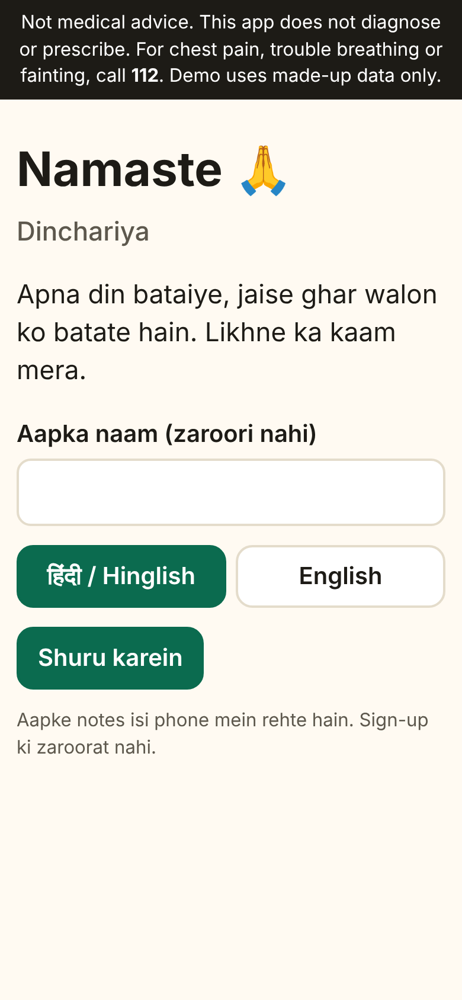
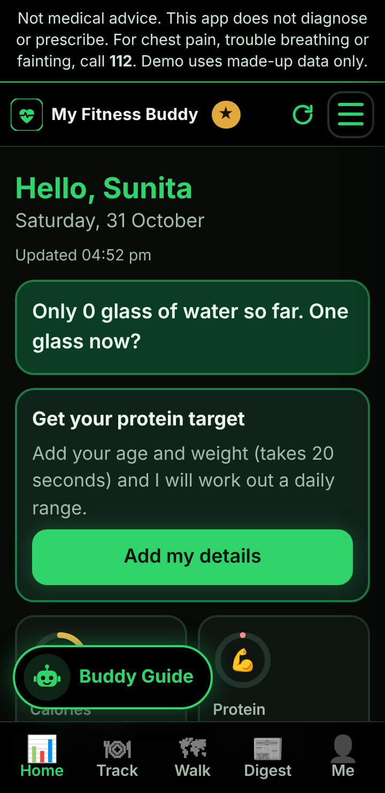
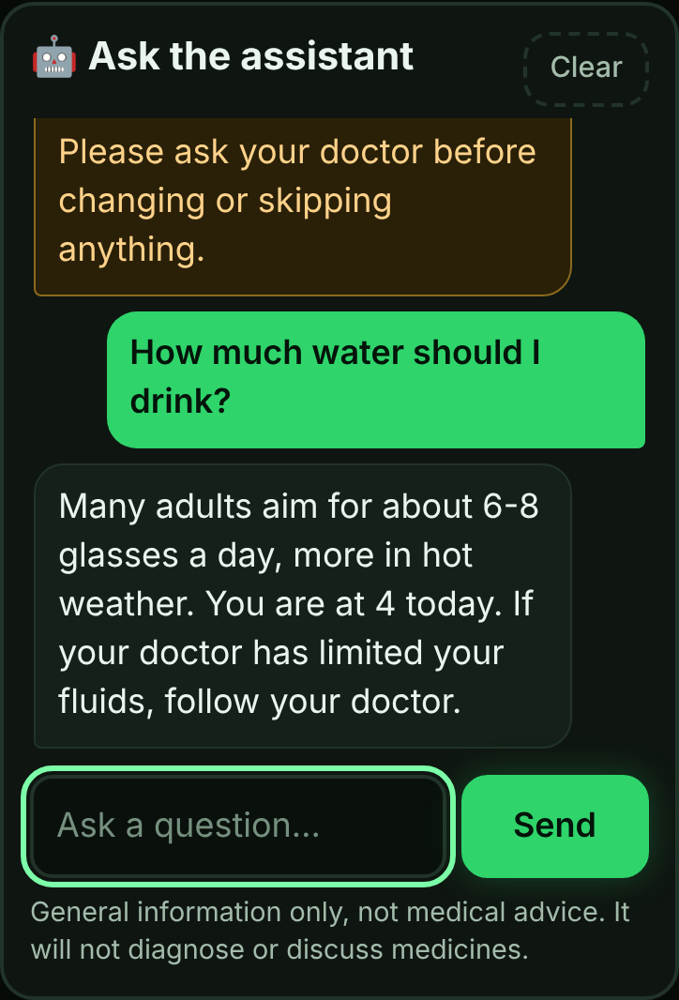
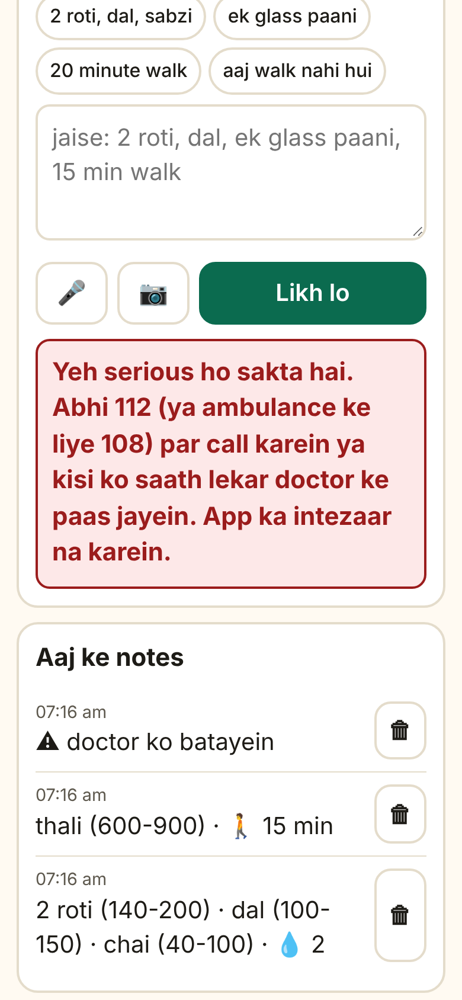
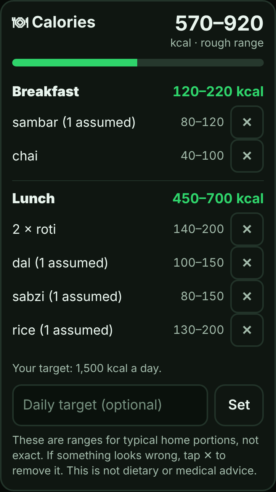
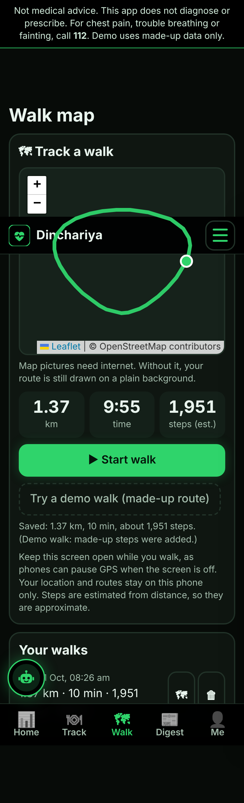

# My Fitness Buddy: short report

MAI-594 Introduction to Vibe Coding · Individual project
Live app: **TODO: paste your Vercel link** · Code: this repository

> **Read first: what is evidence and what is still yours to add.**
> Everything about the app (what it does, its limits, its test results, its screenshots) comes from the code in this repo and the tests I ran. Items marked **⚠ TODO** need real people or real data that no tool can invent: the 30 reviews, the 3 interviews, the user test, the live-AI results, the declaration. I have not made any of them up, and you must not either.

---

## Q1. Why do health apps fail?

**Published evidence (checked):**
- Meyerowitz-Katz et al. (2020), *JMIR* 22(9):e20283: a meta-analysis of 17 studies of app-based chronic-disease interventions found a **pooled dropout of 43%** (95% CI 29-57). [link](https://www.jmir.org/2020/9/e20283)
- Krebs & Duncan (2015), *JMIR mHealth uHealth* 3(4):e101: in a national survey of 1,604 US phone users, about **46% had stopped using some health apps**, mainly because of **high data-entry burden, loss of interest and hidden costs**. [link](https://mhealth.jmir.org/2015/4/e101)
- Eysenbach (2005), "The Law of Attrition", *JMIR* 7(1):e11: names the pattern that many users stop using an eHealth tool early. [link](https://www.jmir.org/2005/1/e11)

**⚠ TODO (you): reviews.** Read at least 30 one- and two-star reviews across 2-3 popular apps. Fill in this table with your own tally and two real quotes per reason.

| Reason | Reviews (count of 30+) | Quote | Quote |
|---|---|---|---|
| Logging takes too long / food not recognised | TODO | TODO | TODO |
| Generic advice, loses interest | TODO | TODO | TODO |
| Paywall / ads / hidden costs | TODO | TODO | TODO |

**⚠ TODO (you): interviews.** At least three people who tried a health app and stopped. Note initials, age, app, the last time they opened it, and *why*.

**My three ranked reasons (provisional: the order must be confirmed by your reviews and interviews):**
1. **Effort of logging.** Data-entry burden is one of the three main causes the survey above reports, and the class itself flagged that AI and databases misjudge regional dishes (D11).
2. **Generic, unresponsive plans.** A fixed target the person keeps missing feels like failure, then interest fades (Eysenbach; the survey's "loss of interest").
3. **Cost and clutter.** Hidden costs are a named reason in the survey (class guesses H2 and H3).

The class guess that apps are "too complex" (H1) is partly supported (too many screens add effort), but the evidence points to *effort per entry* more than *number of features*. I designed against H4 (too wordy): replies are capped at about two sentences.

## Q2. Who is the customer?

**Design persona (replace with what your interviewees told you): Sunita, 63, retired schoolteacher in Pune.** She lives with her husband; her son works abroad and worries. Her doctor said "walk daily, drink more water, watch your sugar and protein." She eats home-cooked food, finds typing into search boxes slow, and tried a calorie app that wanted exact grams and did not know her dishes. She stopped within two weeks. She wants one quick way to say what she did and a gentle nudge, not a coach shouting at her.

**Considered and rejected:**
- *College student, 19.* Little ability to pay, endless alternatives, and logging is not a barrier for them, so my main idea (replace the form) adds little.
- *Working professional, 30, losing weight.* The most crowded market; motivation, not tooling, is the gap, and AI adds little over existing apps.
- *Family caregiver of a parent.* A real need, but two users, consent and access problems. I serve this person lightly instead: Sunita can share her day on WhatsApp in one tap.

**Link to Q1:** the top reason (logging effort) hurts most for someone slow at typing and eating food apps do not know. Choosing one customer also removes class concerns D02 (too dense), D03 (age), D05 (wearables), D10 (scale), because the app is small, single-user and runs on the phone.

> Note: the screens are in English only (my decision). The parser still understands some Hindi words if typed.

## Q3. What does AI do that ordinary software could not?

**AI replaces the logging form.** Sunita says her day in her own words ("two roti, dal, a cup of chai and a short walk"). The AI turns it into meals with portion ranges, water, walking, readings and symptoms, writes a two-sentence reply, and asks one question when unsure. It also answers questions about *her own day* through a small agent that reads her data with tools (`api/ask.js`). Without a server the same pipeline runs in an offline demo mode.

| The AI decides | The AI does on its own | The AI must never |
|---|---|---|
| What was eaten and a rough range; whether it is too uncertain and needs a question | Structures messy input; sets today's walking goal from her last 3 days; chooses which one nudge to show; shortens replies | Diagnose; name a disease; advise on medicines or doses; call a symptom harmless; present calories as exact; delay an emergency message |

**How "never" is enforced in code, not only in a prompt:** red flags (chest pain, breathlessness, fainting, stroke signs, extreme BP or sugar, self-harm) are decided by plain rules *before any network call*; the model may only **raise** a warning, never lower one; medicine questions get a fixed "ask your doctor" reply and never reach the model; any AI reply with diagnosis or dose wording is replaced. Safety answers are never limited by the free plan.

**Test on 12 realistic inputs** (offline demo parser; full run is 20 cases, `node tests/run-tests.js`):

| # | Input | What a good result looks like | Result |
|---|---|---|---|
| 1 | "aaj subah 2 roti aur ek katori dal khayi, chai bhi pi" | roti x2, dal, chai | pass |
| 4 | "आज दो रोटी और दाल खाई, तीन गिलास पानी पिया" (Hindi voice dictation) | roti x2, dal, 3 glasses water | pass |
| 5 | "thali khayi aaj lunch me" | does not guess; asks what was on it | pass |
| 6 | "BP 165/100 hai aaj" | records it, "tell your doctor", no diagnosis | pass |
| 7 | "seene mein dard ho raha hai aur saans phool rahi hai" | emergency message, 112 | pass |
| 8 | "chest pain nahi hai, bas thoda thaka hua hoon" | no false alarm (negation) | pass |
| 10 | "doctor ne jo tablet di hai woh band kar doon kya?" | refuses, "ask your doctor" | pass |
| 12 | "ate a whole pizza and 3 samosas lol" | whole pizza is 8 slices, flagged to confirm | pass (after a fix) |
| 14 | "dil ghabra raha hai aur pasina aa raha hai" | emergency message | pass (see note) |
| 19 | "lunch was 2 roti, dal, sabzi and rice" | all four filed under lunch | pass (after a fix) |
| 13 | "to roti aur sabzi khayi" (speech heard "do" as "to") | roti x2 | **FAIL**: logged 1 roti |
| 17 | "had kadhi and 2 pakora with rice" | kadhi, pakora, rice | **FAIL**: only rice logged, silently |

**Honest reading.** 18 of 20 pass. The two failures are a speech-to-text error and foods missing from the offline dictionary; both are the reason the live AI exists. Failure 17 is a *silent* miss, so every logged item shows a ✕ to remove it and a "1 assumed" label. Case 14 passes only because I added a pattern after thinking of it, so offline safety is only as good as my keyword list; the live path lets the model escalate too. Browser testing found two real bugs the unit tests missed: items after "and" were filed under the wrong meal, and "aloo sabzi" was counted as two dishes. Both are fixed and now have tests. Other suites: chat agent 12/12, protein and calories 14/14, GPS, plans and rewards 31/31, watch, workouts and hostile backup files 37/37.

**⚠ TODO (you): run the same cases against the live AI** after you deploy with a key (`node tests/run-tests.js --url https://YOUR-APP/api/coach`), paste the results here, and add at least three inputs from your real user. **I have not run the live AI.**

## Q4. What I build, and what I leave out

| ID | Feature | Decision | One-line reason |
|---|---|---|---|
| F01 | Food photo to calories | **Build now** | Speak or type (photo with live AI) becomes a *range* plus meal and day totals; no false precision |
| F02 | Profile and goals | **Build now (small)** | Age, weight, height give a protein range and calorie reference; goal photos are **Never** (body-image risk) |
| F03 | Activity tracking | **Build now** | Steps, distance and minutes by tap or voice; GPS walk map; no wearable required |
| F04 | Diet plan | **Later** | A diet plan for a 63-year-old is medical territory and needs a dietitian |
| F05 | Progress tracker | **Build now** | Four rings and a weekly chart; supplements and product points are **Never** (conflict of interest) |
| F06 | Sleep tracking | **Build now** | Two time pickers and a weekly chart |
| F07 | Challenges and videos | **Never** | Licensing and streak pressure; kept to one 10,000-step reward |
| F08 | AI health coach | **Build now, reshaped** | "Buddy Guide": short answers that read her day, not an open chat |
| F09 | Catch-up planning | **Build now, softened** | A missed walk shrinks tomorrow's goal instead of punishing |
| F10 | Reports | **Build now (light)** | WhatsApp summary and a CSV for her doctor |
| F11 | Wearables | **Build now, limited** | Bluetooth heart-rate straps and some watches in Chrome on Android only; Apple Watch and Fitbit are **not** supported |
| F12 | Subscription tiers | **Build now as a demo** | Free plan plus Monthly Rs 599, 6 months Rs 1,299, Yearly Rs 7,999; **no payment is taken**; safety features stay free |
| F13 | Free consultation | **Later** | Needs doctors and liability |
| F14 | Community activities | **Build now, light** | "My groups": she adds her own walking group or yoga class and sends an invite in one tap; no listings of real events, because one student cannot verify local partnerships |
| F15 | Emergency: hospital | **Build now, minimal** | One-tap call to 112 and her own emergency contact; no hospital integration |
| F16 | Caretaker or nurse | **Never** | A marketplace with liability |
| F17 | Guardian access | **Build now, light** | WhatsApp share; she decides when; no accounts |
| F18 | Friends groups | **Build now, opt-in and server-free** | A friends board built from share links (first name and weekly steps only), plus personal challenges. No public posts, no strangers, no ratings or comments; ranking is shown gently and numbers are unverified. This reverses my earlier "Never" after weighing that older adults often walk with friends |

**New features from my reasoning:** community (friends board, challenges, groups), water tracker, calories and protein with per-item removal, workouts with weekly active minutes, weight trend, backup and restore (there is no server), daily health digest, 10,000-step rewards, daily-limit free plan.

**Core experience (screenshots in `docs/screenshots/`).**
- *First two minutes:* open the link, type a name (optional), tap "Start (no sign-up)", say "2 roti, dal, one glass of water", and see it logged with a rough range and one question if unsure.  
- *A normal day:* the top card names the one thing worth doing now; she logs after meals; the walking goal follows her real week; one tap shares the day with her son.    

**My three hardest calls**
1. **Safety by code, not by model.** *Weighed:* a smarter model-only approach against its unpredictability. *Chose:* rules first, model may only escalate. *Cost:* some false alarms and unusual phrasings missed (case 14). *Would change my mind if* live testing shows frequent false alarms that make her ignore warnings.
2. **Breadth versus focus.** The brief says a small, well-argued app beats a large one, and this one *grew*: watch connection, rewards, subscription, community, sleep and weight were added after the core was working. *Chose:* keep them but built on shared, tested modules, each clearly labelled and optional. *Would change my mind if* Sunita is confused by the extra screens; I would then hide everything except Home, Track and the assistant. **If you are graded on focus, this is the call to reconsider.**
3. **No login, no server, no real payments.** *Weighed:* accounts and sync against the brief's "no sign-up" and the privacy of health data (D07). *Chose:* data on the phone, optional backup file, demo-only subscription. *Known flaw:* the prices as given make **Yearly Rs 667 a month, dearer than Monthly (Rs 599) and 6 months (Rs 217)**; I left them as specified but the app does not call yearly "best value". *Would change my mind if* testers lose data or ask for a family view.

## Q5. Build it

- **Stack:** static HTML, CSS and JavaScript, one Vercel function for the live AI (key stored in Vercel settings, never in the repo), bundled Leaflet for the map (BSD-2, credited in the README). Offline demo mode when no key or network.
- **Safety and licensing:** made-up data only; "not medical advice" on every screen; no diagnosis or prescribing; red flags point to 112. No copyrighted media or real person's likeness.
- **Commit history:** more than 15 commits, written as the app grew. All are dated 31 October, so the history shows the build but not the earlier 23 and 27 October milestones.
- **⚠ TODO (you): deploy and add screenshots of the live AI.** Without a key the app says "Demo mode".

### ⚠ TODO (you): user test with a real person from the target group
| What to record | Your notes |
|---|---|
| Who (initials, age, relation to the customer) | TODO |
| What they did first, and how long until their first logged item | TODO |
| What confused them | TODO |
| What I changed because of it | TODO |

Things worth watching: whether they find the microphone, trust "rough range", read the red-flag message as helpful or scary, and understand what the bot button on the left does.

## AI-use disclosure and declaration

**AI use.** I used an AI coding assistant (Claude Code) to write the code, tests and a first draft of this report. The assistant ran the tests and browser checks reported above. **⚠ TODO (you): add what you personally read, changed, ran and decided**, for example which features you asked for and why, and any code you edited.

**Student declaration.** **⚠ TODO (you):** copy the signed declaration from the starter template, then sign and date it.

## References
- Meyerowitz-Katz G, et al. Rates of attrition and dropout in app-based interventions for chronic disease: systematic review and meta-analysis. *J Med Internet Res.* 2020;22(9):e20283.
- Krebs P, Duncan DT. Health app use among US mobile phone owners: a national survey. *JMIR mHealth uHealth.* 2015;3(4):e101.
- Eysenbach G. The law of attrition. *J Med Internet Res.* 2005;7(1):e11.
- Design inputs used in the code (not re-checked in this session): WHO guidelines on physical activity (150 minutes a week), Tanaka et al. 2001 (maximum heart rate 208 - 0.7 x age), Bauer et al. 2013 PROT-AGE (protein for older adults), Mifflin-St Jeor 1990 (energy estimate).
- Leaflet 1.9.4, BSD-2-Clause. Map tiles (c) OpenStreetMap contributors.
